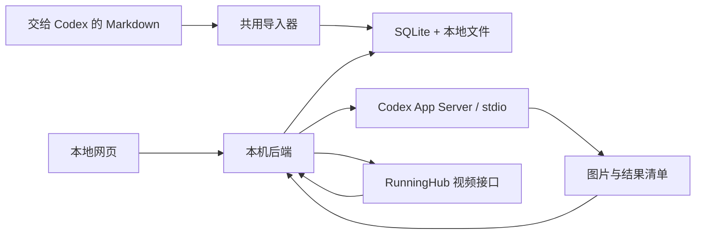

# 分镜资产工作台：具体实施方案

设计日期：2026-10-13  
项目目录：`E:\airi\storyboard-studio`  
状态：方案与项目资料初始化；尚未开发应用、生成图片或提交新视频任务。

## 1. 已确定的使用方式

以《奶油变心后，我爱上了红烧肉》为第一个作品，做一个本机使用的网页工作台。首版把“导入分镜 → 整理资产 → 编辑 → 生成图片 → 生成镜头视频 → 选择版本”做通。

采用用户已明确的分工：

| 操作 | 入口 | 执行方式 |
| --- | --- | --- |
| 导入这种格式的 Markdown | 将文件交给 Codex；也支持网页上传 | 同一个确定性导入器解析，Codex 调用它即可 |
| 修改名字、描述、台词、镜头参数 | 网页直接编辑 | 本机后端保存新版本 |
| 整理设定、改写提示词、生成或重生图片 | 网页 Agent 操作区，或当前 Codex 会话 | Codex Agent 处理，图片落盘，后端登记 |
| 显示新图片 | 刷新网页 | 读取已登记的本地版本；可重复刷新 |
| 生成或重新生成视频 | 镜头详情中的按钮 | 网页调用本机后端，后端直接调用 RunningHub；不经过 Agent |
| 查看发送内容 | 生成按钮旁的预览区 | 展示完整提示词、参考素材与版本、实际参数、去掉认证信息的请求 |
| 选择满意结果 | 版本列表中的“采用” | 更新采用版本，保留其他版本 |

“网页直接调用 RunningHub”指绕过 Agent，API Key 始终由本机后端持有。浏览器不直接携带密钥访问 RunningHub。

首版不做自动剪辑、发布平台、多用户、云端部署或复杂工作流编排。视频文件和选用顺序可以导出，之后再接剪辑。

## 2. 第一份文件实际包含什么

源文件：`E:\airi\aimengchong\萌宠短视频项目\作品\泡芙\奶油变心后_分镜提示词.md`  
SHA-256：`CE671E9C0D45D4010FE8ACA8997398470D1249E82FCBE10944D5C41021263A8C`

| 内容 | 导入结果 |
| --- | --- |
| 项目元数据、全局风格 | 作品名称、主题、画幅、风格和色彩阶段 |
| 角色设定库 | 6 个条目：泡芙、奶油、红烧肉、螃蟹、草莓，以及甜品群演组 |
| 场景设定库 | 6 个地点资产 A–F |
| 完整分镜 | 8 场剧情、45 个镜头 |
| 角色与场景种子词 | 保留为可编辑提示词字段，不与原文混写 |
| 一致性表、速查表、伏笔表 | 保留原表，同时生成问题与关联信息 |
| 道具 | 原文没有独立道具库，先形成 14 个候选条目，待确认 |
| 图片、音频、视频 | 此 Markdown 未直接附带这些媒体；导入后显示“尚未生成/未绑定” |

14 个道具候选：手机、订婚喜帖、糖霜戒指、戒指盒、爱心卡、礼盒、笔、午饭托盘、酱汁盒、日期便签、试味样品、试味本、联名合约、品牌招牌。它们来自文本推断，不直接当成已确认资产。

地点资产与剧情场次分开管理。例如地点 E 是厨房/摊位，多个剧情场次都可以发生在这里；不能把 8 场剧情误做成 8 个背景图。

### 导入时立即显示的问题

| 问题 | 工作台处理 |
| --- | --- |
| 45 镜时长相加为 160 秒；速查表写约 155 秒；项目目标为 200–240 秒 | 同时显示三个数字，保留差异，不自动拉长镜头 |
| `05-A` 编号指向 A，画面和速查表却是“店铺夜” | 建立场景冲突，地点归属等待确认 |
| 伏笔表引用 `31-C`，实际镜头是 `31-E`，且其内容并非表中描述的同一承诺 | 建立失效引用，不只机械替换字母 |
| 爱心卡在 `07-B`、`15-C` 与 `22-D`、`26-D` 等处状态有差异 | 道具支持完整/半颗等状态，并要求确认连续性 |
| `27-B/E` 是跨地点蒙太奇 | 一个镜头允许关联多个地点；需要时可显式拆分，原编号仍保留 |
| `17-D` 标注 2S，但构图涉及泡芙、草莓和螃蟹三人 | 标出人数与景别冲突 |
| 螃蟹沿用前作外观，但本文件未给出最终参考图 | 标记缺少已确认参考，不假装已有一致角色图 |
| C 含店铺/新店，E 含厨房/摊位 | 保留别名，确认后可建立地点变体 |

这些问题不妨碍导入和编辑。涉及视频提交的必需参考图、接口参数等缺失时，才禁止提交对应任务。创作连续性问题可以显式标记已知，不必阻塞全部作品。

原目录存在的角色三视图、音色、旧分镜图片等，只在用户选择后绑定。不会自动扫入附近所有文件；如果选入 16:9 素材，会提示它与本项目 9:16 的区别。

## 3. 页面怎么用

### 页面结构

```text
顶部：作品名 | 原文/当前版本 | 导入文件 | 刷新资产
左侧：概览 / 角色 / 场景 / 道具 / 镜头 / 任务
中间：当前分类的列表或图片卡片
右侧：选中条目的编辑器、引用关系和版本记录
生成区：完整发送预览  |  生成按钮、状态和结果
```

| 页面 | 主要内容与动作 |
| --- | --- |
| 概览 | 原文来源、角色/场景/镜头数量、160 秒当前合计、待确认问题 |
| 角色 | 图片卡片、名字、外观、特征、视觉提示词、一致性词；编辑、交给 Agent 重生、采用版本 |
| 场景 | 地点 A–F、环境、光线、氛围、变体、参考图；同样支持编辑和重生 |
| 道具 | 候选确认、道具状态、参考图、使用镜头 |
| 镜头 | 按 8 场分组的 45 镜列表；缩略图、时长、相关角色/地点、图片/视频状态 |
| 镜头详情 | 景别、构图、运镜、动作、对白、情绪、转场、计划剪辑时长、图片与视频版本 |
| 任务 | Agent 与 RunningHub 分栏；显示进度、错误、请求快照、可重试操作、产物位置 |

镜头列表首版采用可排序列表和分组，不做拖拽时间轴。顺序变更通过明确的上移/下移保存。

### 镜头详情的生成区

左右并排：左边编辑，右边预览；窄屏上下排列。不要把完整提示词藏在生成后的日志里。

预览区包含：

1. 本次生成的是角色图、场景图、道具图、分镜图，还是镜头视频。
2. 最终提示词全文，支持复制和展开；没有省略号代替被发送的内容。
3. 实际包含的全局风格、角色/地点/道具描述、动作、构图、运镜、对白、声音、限制词等分段。
4. 每张实际参考图的缩略图、名称、采用版本与位置；参考音频/视频同样列出。
5. 画幅、生成时长、参考槽位、工作流等实际参数；计划剪辑时长另列。
6. 去掉认证信息的请求详情，便于检查参数映射。

“保存编辑”“让 Agent 修改”“生成图片”“生成视频”是不同动作。保存文本不会自动调用生成。Agent 给出的提示词修改也形成新版本，用户可以直接修改或恢复。

在网页接入尚未就绪时，同样可以把文件交给当前 Codex：导入、生成、放进指定目录，再刷新工作台。两种入口共用同一落盘协议。

## 4. 数据和版本规则

### 核心对象

| 对象 | 要保存的内容 |
| --- | --- |
| Project | 稳定 ID、作品名、画幅、全局风格、目标时长、采用版本 |
| Import | 原始 Markdown、文件哈希、导入时间、解析器版本、原文行号 |
| Asset | 稳定 ID、类型 character/location/prop/shot-frame、名称、别名、状态 |
| AssetRevision | 描述/提示词快照、图片路径与哈希、父版本、生成记录、采用状态 |
| StoryScene | 8 场剧情的标题、顺序、剧情说明；与地点资产分开 |
| Shot / ShotRevision | 稳定 ID、原编号、所属剧情场、关联资产、镜头字段、提示词、时长和顺序 |
| GenerationJob | 类型、冻结输入、预览哈希、状态、Agent 会话或远程 taskId、费用信息、输出 |
| Issue | 对象/原文位置、冲突内容、是否推断、处理状态与说明 |

SQLite 保存已登记对象、编辑版本、采用指针和任务状态；文件系统保存原文和媒体。JSON 清单只是 Agent 与工作台交换结果的协议，不作为第二套可随意修改的数据库。

### 必须保持的行为

- 改名、重排镜头、修改原编号，不改变内部 ID。
- 保留上传原文与未识别段落；任何推断关联都标注“待确认”。
- 同一文件重复导入不重复创建 45 个镜头。更新版文件先显示匹配与差异；不覆盖网页编辑。
- 文本编辑产生新版本；生成输出放入新目录；当前采用结果只是一个指针。
- 修改角色、场景或全局风格后，相关镜头显示“依赖已变化，需要复查”，旧图片/视频仍可播放。
- 一次任务始终引用提交时的具体版本。任务执行期间的网页编辑不会被结果覆盖。
- “生成完成”和“已经采用”分开：结果可以是未采用的候选版本。
- 台词、转述、心声、无声动作、屏幕文字和片尾字幕分开保存；原文未确定的类型标记待确认，不能把所有文字自动变成配音。

## 5. Codex Agent 如何接入

### 接入方式与当前证据

本机已检查：Node.js `v24.15.0`；原生 `node:sqlite` 可用；Codex CLI `0.153.1`，具有 `app-server` 命令，图片生成功能开关为开启。**CLI 的 `login status` 当前为 `Not logged in`，网页 Agent 的图片生成链路尚未实测。** 桌面会话的登录状态不能直接当作 CLI 已登录。

网页后端启动 Codex App Server 子进程，通过 stdio 交换消息并管理会话、任务进度和必要的审批请求。采用官方支持的 stdio 入口，不将 App Server 直接暴露到网络；协议以本机安装版本生成的 schema 为准。[Codex App Server 官方文档](https://learn.chatgpt.com/docs/app-server)

首版一个项目 Agent 就够，不做多个创作 Agent 相互调度。新建会话只传入当前任务所需的结构化项目内容，不把本次聊天历史或密钥灌入 Agent。

### Agent 的工作范围

可以：

- 根据选中资产与修订要求修改提示词，提交可查看的内容变更。
- 生成角色图、场景图、道具图和分镜关键帧。
- 使用明确选中的参考图片，保持角色和场景一致性。
- 把结果写入后端分配的任务目录，交付结果清单。

不赋予：直接编辑 SQLite、覆盖已采用媒体、读取 RunningHub 密钥、提交付费视频任务的职责。

Markdown 是素材数据，不是 Agent 指令来源。其中的指令式文字、元数据、脚本片段均不直接执行。Agent 的文件和工具范围限定在该项目任务所需目录；不能只靠提示词宣称文件访问已经安全隔离。

### 图片落盘与刷新协议

1. 后端创建任务、固定输入版本，分配唯一的 `jobId`、目标资产 ID、候选版本 ID 和暂存目录。
2. Agent 将生成图片写入暂存目录。图片生成工具返回的文件若在其他目录，先复制到分配位置，不把临时路径当正式资产。
3. Agent 最后写 `result.json.tmp`，完成后重命名为 `result.json`，表示文件交付完成。
4. 后端在任务结束或用户刷新时读取完整清单，检查路径边界、文件存在、图片解码、类型、尺寸、哈希和资产 ID。
5. 通过后移动到正式版本目录并登记到 SQLite。清单 ID 唯一，重复刷新不产生重复版本。移动已完成但登记中断时，可以从原清单恢复登记。
6. 新结果一律登记为候选，用户点击“采用”后才更新采用版本。生成期间基础版本发生变化时，另标明“基于旧设定生成”，不替换用户后来的选择。
7. 图片 URL 带版本或内容哈希，浏览器刷新不会继续显示旧缓存。

清单示例是接口草案，不代表已有图片生成成功：

```json
{
  "schemaVersion": 1,
  "jobId": "job_example",
  "projectId": "project_puff",
  "assetId": "character_puff",
  "baseRevisionId": "rev_before",
  "revisionId": "rev_candidate",
  "kind": "image",
  "files": [{ "path": "image.png", "sha256": "<由实际文件计算>" }],
  "promptSnapshotPath": "prompt.json"
}
```

文件路径是相对于该任务暂存目录的路径，拒绝绝对路径、`..` 和越界的符号链接。后端决定正式目录和采用状态，Agent 不自行更改它们。内容修改也携带 `baseRevisionId`；存在并发编辑时展示差异，不采用最后写入覆盖。

首版只需要“任务完成登记 + 网页刷新”，不做文件监听服务。没有采用版本时，卡片展示最新候选并标注“未采用”；已有采用版本时，保留它并显示新候选入口。随便拖进目录的一张图片不会被猜成某个角色；可用“导入图片”显式绑定。

### 接入第一步的验收门槛

实施时先完成 CLI 登录和工具能力验证，再跑“一张场景图 → 暂存 → 登记版本 → 网页刷新显示”。同时验证是否能在图片工具调用前校验提示词和参考素材。两项通过后，才扩展到角色和镜头图片。功能开关开启不能代替真实验收；如当前 App Server 无法使用图片工具，需要先解决能力接入，不静默改走另一套收费接口。

本机协议 schema 已确认有 `imageGeneration` 结果项及 `savedPath`、`revisedPrompt` 等字段，但目前未确认内置生图工具的调用前校验入口；`item/tool/call` 是动态工具调用，不能直接当成内置图片工具的拦截能力。因此“严格验证图片工具实际入参等于预览”是接入阶段的关键待验项，不能以结果通知代替。若内置能力不支持，需解决受控工具接入后再开放满足该要求的生图按钮。

## 6. 发送前预览与实际请求如何一致

两条生成路径都先准备请求，后提交同一份请求。

```text
编辑内容/选择版本
       ↓
准备：确定引用 → 组合提示词 → 校验参数 → 上传必要素材
       ↓
完整预览 + 不可变 snapshotId/hash
       ↓
点击生成：校验快照有效 → 保存任务 → 发送原快照
```

- 图片请求预览包含 Agent 任务说明、项目规则、选中的原文片段、最终图片提示词与参考素材；Agent 整理提示词和实际生成必须分为两个动作，不能把“自动重写后立即发送”藏在按钮里。生图执行阶段只能使用冻结内容；接入层需在实际工具调用前校验提示词及参考素材，能力未验证前不能声称已经实现发送一致性。
- 视频提示词分段组合后可直接编辑最终全文。后端按最终全文原样发出，不在提交时让 Agent 润色。
- JSON 详情显示所有对结果有影响的映射字段。素材上传后的远端文件标识也写进最终快照；只有请求准备成功才能提交。
- 修改提示词、角色版本、参考图、工作流、画幅或时长，旧快照立即失效，需要重新准备并查看；无需额外增加一个重复确认弹窗。
- 提交时检查当前对象版本仍匹配快照，同时验证参考文件哈希。旧页面提交收到明确的版本冲突提示。
- API Key 与认证头从不进入预览、快照或导出。供应商和模型内部不可见的指令不声称可以预览；如果工具报告实际修订提示词，记录在结果元数据中。
- 该 RunningHub 工作流内部是否还会改写提示词，需在接入时核对对应节点与开关。未经验证，不将“HTTP 请求原样发送”夸大为“下游模型内部也没有改写”。

## 7. 视频直接走 RunningHub

### 可复用的已验证部分

此前已完成一笔真实测试：

- 工作流应用：`2084320751339032577`。
- 提交：`POST /openapi/v2/run/ai-app/2084320751339032577`。
- 查询：`POST /openapi/v2/query`。
- 文件上传：`POST /openapi/v2/media/upload/binary`。
- 默认示例成功返回视频和 ZIP；视频实际为 480×864、24 fps、10.125 秒。
- 该笔测试消耗 32 RH 币。这个数字只代表当次配置，不能当作所有模式的固定报价。

已验证的是默认示例的 10 秒调用。本故事的参考素材、短时长配置、图生视频模式和最终质量尚未验证。

### 工作流字段如何落到界面

| 已看到的字段 | 界面含义/处理 |
| --- | --- |
| `150.value` | 主要视频提示词；预览并原样提交最终全文 |
| `141/142/143.image` | 三个图片槽位，逐一显示绑定素材和版本 |
| `161/175/176.image` | 2026-10-25 补齐参考图4至6；后端模板已有这些图片节点，前端分配、编号与槽位现同步为共6图 |
| `164.video` | 参考视频；不能继续沿用测试示例的视频 |
| `115.aspect_ratio` | 画幅；现有成功示例为 `9:16 (Portrait Widescreen)` |
| `186.value` | 示例值为 `10`；接入时核实支持的生成时长 |
| `159.lora_name` / `strength_model` | 显式显示；测试示例 LoRA 不直接用作本故事默认值 |
| 其余开关、音频、参考图与数值节点 | 从用户提供文档和实际工作流逐项核对用途、必填性、合法值，再开放对应模式 |

现有请求有 22 个节点参数，不能只修改提示词后把其他默认内容原封不动提交。参考素材、LoRA、模式与开关必须完成一套适合本故事的配置验收。2026-10-25 起图片槽位共6个；超过6张时提示用户调整素材方案，不偷偷丢弃角色图。

视频流程：选择具体版本的角色/场景/关键帧 → 准备并上传素材 → 显示完整请求预览 → 点击生成 → 后端提交 → 保存 taskId → 查询 → 下载到本地 → 校验 → 展示候选视频。

计划剪辑时长与实际生成时长分开。例如镜头计划 3 秒，当前已验证的生成配置是 10 秒，界面必须明确展示二者。是否能直接生成 3 秒需先验证；不能自动把所有镜头改为 10 秒。

实现（2026-10-13）：生成时长为可编辑字段，计划剪辑时长只作本镜的默认值（未手动改过时填入），改过则按镜头记住；两者不一致时在核对区给出红字说明；若启用「时长与比例」提示词区块，其中的 Target duration 跟随实际生成时长。

### 第二档：首尾帧（FL2VA）

2026-10-13 核实：上面这个多参考应用没有首帧/尾帧槽位，`141/142/143.image` 是泛化的参考图 1–3，走的是 H3 的 Ref2VA 路径。要真正做首尾帧必须另接一个 FL2VA 工作流，因此新增第二档：

- 工作流应用：`2084282198664007682`（H3 Image-to-Video & First/Last Frame）。
- 只用 8 个可调节点：`137.image` 首帧、`143.image` 尾帧、`159.value` 尾帧开关、`142.value` 像素/百万、`135.value` 时长、`136.prompt` 提示词、`174.value` 仅Zip输出、`175.strength_model` LoRA 强度。**没有比例节点**，输出比例跟随首帧。
- 时长按该应用作者标注的 5–15 整数秒，像素/百万 0.2–2.0。尾帧开关关闭即单图生视频。
- **图2（`143`）永远不会留空**：它是 LoadImage，空槽会让工作流直接跑不起来（应用作者的原话是「要关开关，别删图片」）。所以只要没有明确选尾帧，就把首帧那一份上传文件复用它——同一份文件只上传一次，`159` 按关闭下发（复用不算真尾帧，免得变成首尾同帧的静态片）。明确选了两张图才是真的首尾帧。
- 两档节点号不冲突但含义会变：`143` 在多参考档是参考图3、在首尾帧档是尾帧，因此绑定、LoRA 与占位编号一律按**字段名 + 当前档位**判定，不按节点号猜。

实现取舍：

- 档位落成 `videoConfig.mode = 'reference' | 'frames'`，各自带 workflowId、nodeInfoList 与参数范围；后端按 `mode`（或 workflowId 兜底）分派，只接受这两个已核对的 workflowId，其余一律阻塞。
- 切档重置槽位绑定，避免同一节点号被两档串用。
- **实例规格（`instanceType`）在“生成参数”区下拉选择，两档共用，默认 `default`（标准 24G）**；可选 `default` / `plus` / `ultra`（24G / 48G / 84G），越高的规格单价越高。取值非法会在生成前阻塞。前端读 localStorage 时将上一版 `plus` 和缺失迁移为标准 24G，仅迁移一次，之后保留手动选择——否则旧的 localStorage 快照会把新默认值一直顶掉（`persistConfig` 会把整份 config 存进 `studio.videoConfig`，而 `loadState` 只在没有本地快照时才采用服务端默认）。
- 首帧尺寸未知时本机导出不报“比例无效”，而是明确说“首帧尺寸未知，请先绑定首帧”，否则会把人引到错误的方向。
- 该工作流的“仅Zip输出”默认关闭；若打开，任务只回压缩包，本工作台不自动解压，直接在结果处说明并提示改回关闭。

界面字段对应：

| 首尾帧档字段 | 界面含义/处理 |
| --- | --- |
| `137.image` / `143.image` | 首帧（必填）/ 尾帧（由开关控制）；用 `<First frame>` / `<Last frame>` 占位，不编号 |
| `159.value` | 尾帧开关；关闭即单图生视频 |
| `135.value` | 生成时长，5–15 整数秒 |
| `142.value` | 像素/百万，0.2–2.0 |
| `136.prompt` | 提示词；预览并原样提交最终全文 |
| `174.value` | 仅Zip输出，默认关闭 |
| `175.strength_model` | LoRA 强度，默认 0，不覆盖工作流有效模型名 |

### 任务与费用规则

- 首版视频并发为 1；一个 SQLite 任务表和本机任务循环即可，不加 Redis 或分布式队列。
- 双击按钮通过唯一操作 ID 去重；任务创建和状态变更用事务保存。
- 状态区分：准备、提交中、提交结果不明、远端排队/运行、下载中、可用、失败。采用结果另行记录。
- 收到 taskId 后先持久化。程序重启继续查询同一任务，不重新提交。
- 提交超时且没有 taskId 时，标记“提交结果不明”；不自动重试收费提交。除非服务端提供可验证的幂等能力，否则不能保证超时后无重复收费。
- 下载失败只重试下载。先写 `.part`，校验可播放及文件完整性后转正；ZIP 如需解压必须防止路径越界。
- 结果链接按文档约 24 小时失效，任务完成后立即下载本地，不能只保存远端 URL。
- “停止本地查询/停止新任务”与“远端取消”分开。未验证远端取消接口时，不把按钮标成可以终止远端计费。
- 预算上限用于阻止后续提交，已有远端任务继续查询。估算、实际扣费、未知费用分开显示，失败任务也不假设免费。
- 仅作量级示例：45 镜若全部按当次 10 秒、32 RH 币配置生成一遍，约 1440 RH 币；真实配置与返修会改变费用。首轮先验收一个镜头，不自动批量提交全部 45 镜。

## 8. 最小技术实现

采用本机已有 Node.js 24，后端使用 Express 与原生 `node:sqlite`；前端用静态 HTML/CSS/JavaScript。无需 Electron、前端构建链、远程数据库或用户账号系统。



后端职责：导入、编辑版本、准备预览、启动 Agent、校验图片交付、提交与恢复视频任务、下载与提供媒体。Agent 不承担这些确定性管理逻辑。

服务仅监听 `127.0.0.1`；本机请求仍校验 Host/Origin，并保护修改接口。图片/视频以对象 ID 提供，不开放任意本地路径读取。视频提供 Range 支持；用户选入的文件先复制到项目并校验类型和大小。

密钥由后端专用环境配置持有；启动 Agent 子进程时显式移除 `RUNNINGHUB_API_KEY`，不使用默认全量环境继承。密钥不写入项目资料、数据库快照、日志、提示词或 Git；用户此前发来的 Key 不复制到本项目文件中。

### 计划目录

```text
E:\airi\storyboard-studio\
  README.md
  docs\实施方案.md
  examples\奶油变心后_分镜提示词.md       # 原文副本，不修改
  public\                              # 实施时创建网页
  server\                              # 实施时创建后端
  scripts\import-md.mjs                 # Codex 调用的导入入口
  data\studio.sqlite
  data\projects\<projectId>\
    imports\<importId>\original.md
    assets\<assetId>\versions\<revisionId>\image.png
    shots\<shotId>\versions\<revisionId>\video.mp4
    jobs\<jobId>\prompt.json
    jobs\<jobId>\request.json
    jobs\<jobId>\result.json
    staging\<jobId>\                   # Agent 只向指定任务位置交付
```

本轮只创建 README、实施方案和原文示例；上面的应用、数据和任务目录在实施时按需创建。

### 主要接口边界

- `POST /api/imports`：导入文件，返回解析计数、来源和问题。
- `GET /api/projects/:id`：项目概览及当前状态。
- `PATCH /api/assets/:id`、`PATCH /api/shots/:id`：携带基础版本保存编辑。
- `POST /api/previews`：准备图片或视频的冻结请求，返回 snapshotId/hash 和完整预览。
- `POST /api/agent-jobs`：提交指定快照的 Agent 任务。
- `POST /api/video-jobs`：提交指定快照的 RunningHub 任务。
- `GET /api/jobs/:id`：状态和可执行的恢复操作。
- `POST /api/assets/refresh`：登记完整图片交付；重复调用无副作用。
- `POST /api/revisions/:id/adopt`：显式采用结果。

Codex 导入命令与网页上传共用导入逻辑，不各写一个解析器。首版解析本文件的标题、JSON 代码块、镜头字段和表格；不承诺任意格式 Markdown 都可完整导入。不认识的部分保留原文并显示提示。

## 9. 实施顺序与可验收结果

| 阶段 | 做什么 | 完成标准 |
| --- | --- | --- |
| 1. 导入与编辑 | 原文留存、解析、资产和镜头页面、问题列表、版本保存 | 显示 6 角色条目、6 地点、8 场、45 镜和 160 秒；刷新保留编辑；重复导入不重复创建 |
| 2. Agent 图片闭环 | CLI 登录/能力验证、工具调用前校验、选中资产任务、图片落盘与登记、完整提示词预览 | 实际生成一张图后网页刷新可见；工具入参与预览一致；再次生成保留两版；并发编辑不被覆盖 |
| 3. 单镜头视频闭环 | 验证本故事所用模式与参考图，预览，直接提交、查询、下载 | 一个选定镜头的请求和预览一致，结果可本地播放；重启可恢复同一 taskId |
| 4. 全作品管理 | 依赖过期提示、候选选择、按场分组、选用清单与媒体导出 | 可逐镜头生产和返修；导出能对应到镜头、提示词与采用版本 |

首版不把付费批量视频提交作为默认动作。图片能力验收与一个视频样片通过后，再决定是否需要批量入口。

### 必要验证

1. 用真实原文验证计数、跨场景 `27-B/E`、160 秒合计、失效引用；导入和重导入不丢原文或人工编辑。
2. 保存编辑后关闭并重新打开，内容与采用版本仍在。
3. 图片不完整或清单无效时不可见；重复刷新不重复登记；越界文件被拒绝。
4. 在 Agent 运行时修改资产，返回结果成为候选，不覆盖新编辑。
5. 预览后改提示词/参考图，旧快照不能提交；发送正文与已确认快照完全相同。
6. 视频双击只建一个任务；有 taskId 时重启续查；未知提交结果不自动重复扣费。
7. 模拟远端失败、断网、下载中断，保持可恢复状态；实际视频可以播放。
8. 浏览器响应、Agent 输入、日志和导出均不含密钥。

## 10. 当前交付与尚未验证的部分

本轮交付实施方案、项目 README 和未修改的原始 Markdown 示例，作为后续开发的输入。

尚未开发工作台或 Agent；未进行本作品的图片/视频生成；未验证 CLI 登录后的图片工具能力、图片工具调用前校验、RunningHub 短时长与新参考配置，也未解决原稿中的创作连续性问题。现有一次默认 H3 示例成功，不能代替上述验收。
